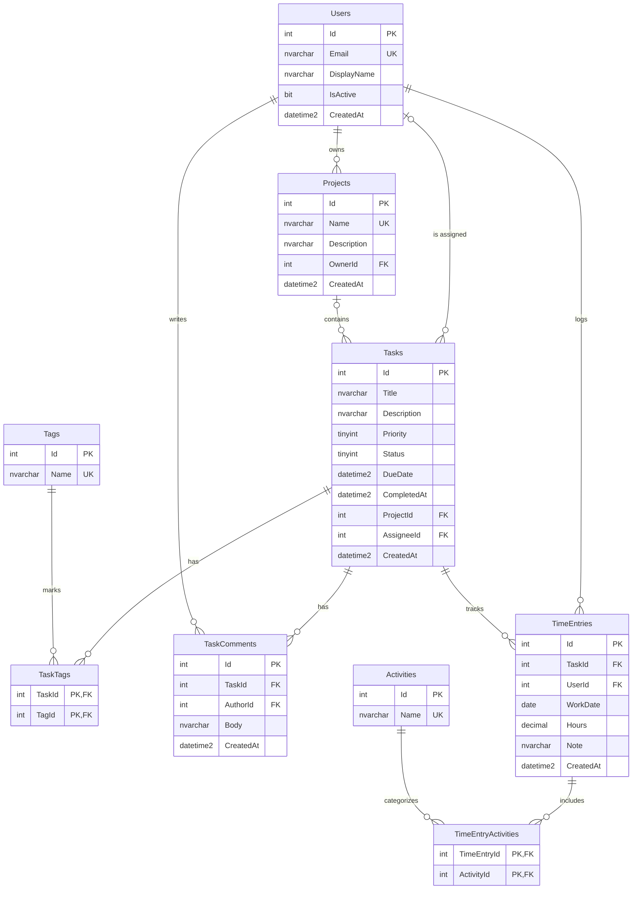

# TaskFlowLab — Entity Relationship Diagram

Diagrama prezintă structura bazei de date TaskFlowLab, inclusiv tabelele pentru gestionarea proiectelor, sarcinilor, comentariilor, etichetelor și evidenței timpului de lucru.

## Relațiile dintre entități

### Relații 1:N

- Users → Projects: un utilizator poate deține mai multe proiecte.
- Projects → Tasks: un proiect poate conține mai multe sarcini.
- Users → Tasks: un utilizator poate avea mai multe sarcini atribuite.
- Tasks → TaskComments: o sarcină poate avea mai multe comentarii.
- Users → TaskComments: un utilizator poate scrie mai multe comentarii.
- Tasks → TimeEntries: o sarcină poate avea mai multe înregistrări de timp.
- Users → TimeEntries: un utilizator poate înregistra mai multe perioade de lucru.
- TimeEntries → TimeEntryActivities: o înregistrare de timp poate avea mai multe activități.
- Activities → TimeEntryActivities: o activitate poate apărea în mai multe înregistrări.

### Relații N:M

- Tasks ↔ Tags: implementată prin tabelul intermediar `TaskTags`.
- TimeEntries ↔ Activities: implementată prin tabelul intermediar `TimeEntryActivities`.

### Constrângeri importante

- `TimeEntries.Id` este cheia primară.
- `TimeEntries.TaskId` referă `Tasks.Id` cu ON DELETE CASCADE.
- `TimeEntries.UserId` referă `Users.Id` cu ON DELETE NO ACTION.
- Combinația `(TaskId, UserId, WorkDate)` este unică.
- `TimeEntries.Hours` trebuie să fie mai mare decât 0 și cel mult 24.
- `Activities.Name` este unic.
- `TimeEntryActivities` utilizează cheia primară compusă `(TimeEntryId, ActivityId)`.
